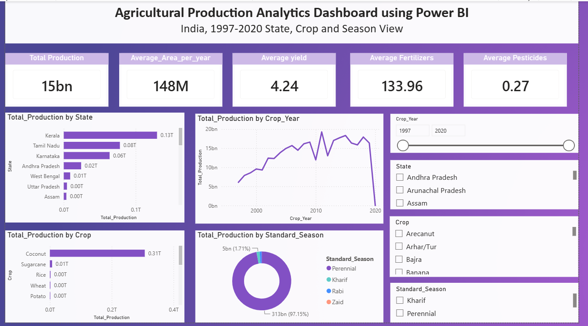

# Agricultural Production Analytics Dashboard (Power BI)

## Overview
Interactive Power BI dashboard analyzing Indian agricultural production
from 1997 to 2020 by state, crop and season.

## Key Metrics
- Total Production: 15bn
- Average Area per Year: 148M
- Average Yield: 4.24
- Average Fertilizer: 133.96
- Average Pesticides: 0.27

## Insights
- Kerala, Tamil Nadu and Karnataka are the top producing states
- Coconut is the leading crop by production
- Perennial crops make up about 97% of total production

## Dashboard Preview

## Tools Used
Power BI, DAX, Power Query, Excel

## Project Files
- `Agri_project.pbix` - Power BI dashboard file
- `Agricultural_dataset.xlsx` - dataset
- `Agricultural_Production_Analytics_Project-final.pptx` - presentation
- `Agriculture.docx` - project report
- `Agriculture_dashboard.png` - dashboard screenshot

## Known Limitation
The 2020 data appears incomplete, which causes the sharp drop at the end of the trend line.

## Author
Shifa Anjum
